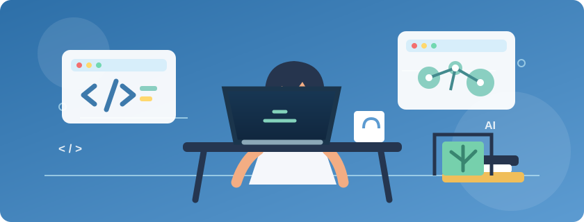

  

  <h1>Hi, I'm Sanjarbek 👋</h1>
  <h3>Software &amp; AI Engineer</h3>

  
I build web applications and explore AI, data analysis, and computer vision.

  
<a href="https://github.com/Sanjarbek9706?tab=repositories">Explore my projects</a>

---

### ⚡ Skills &amp; Technologies

  
  
  
  
  

  
  
  
  
  

  
  
  
  
  

  
  
  
  
  

  
  
  
  

  
  
  
  
  
  

  
  
  
  
  

### 🔍 What I'm exploring

- AI foundations with NumPy and pandas
- Computer vision with OpenCV
- Full-stack applications with React, Next.js, Node.js, and MongoDB
